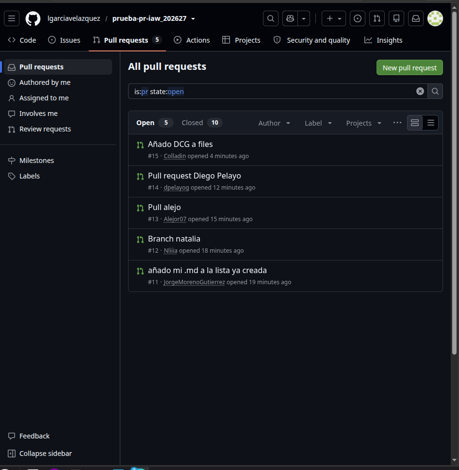

# **Pasos para hacer un pull request**
## **Por:** *Alejo Ruiz*
1. Iniciamos un *Fork* en el repositorio principal.

2. Trabajamos normal en la *copia* (Fork) del repositorio principal.

3. Una vez con todo hecho hacemos el `Git add .` , `git commit -m` y el `git push`.

4. Una vez con el ` git push ` y el resultado final en tu repositorio hacemos ya el ` pull request ` y saldra algo asi :

5. Ahora solo hay que esperar a que alguien con permisos lo acepte y ya estaria.